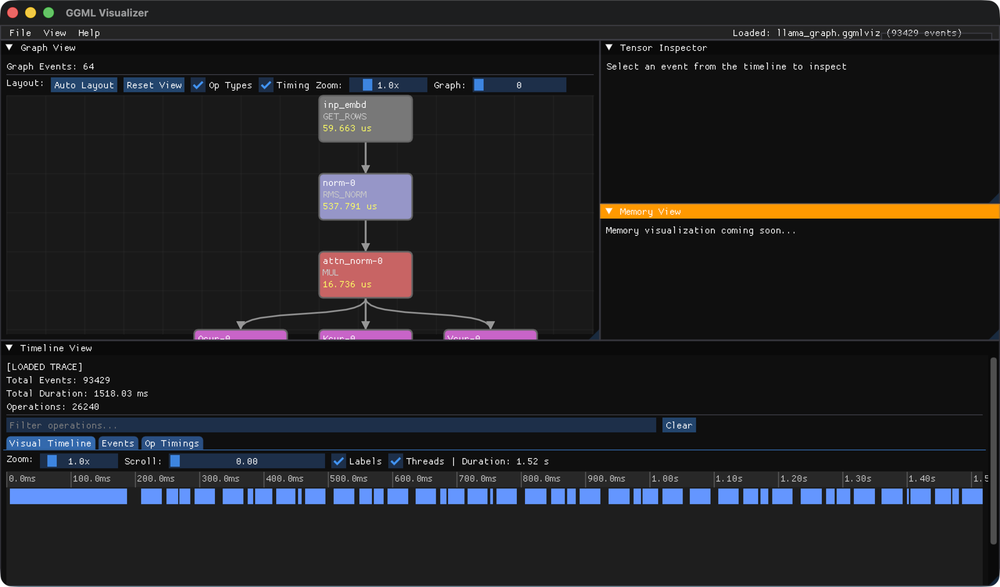
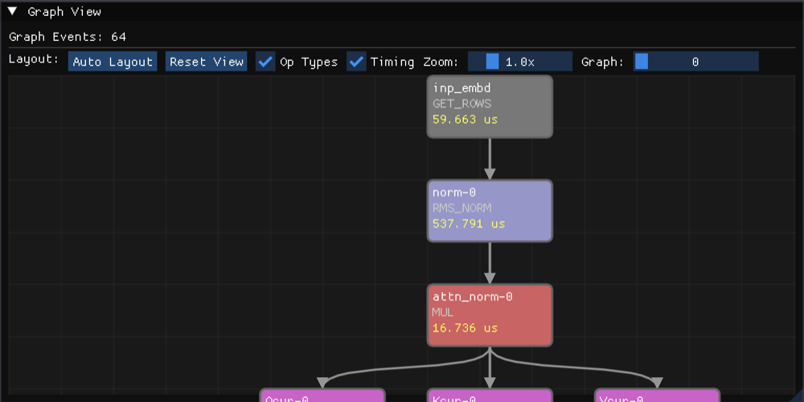

# GGML Visualizer

[ggmlviz](docs/ggmlviz.md) / [build](docs/BUILD.md)

**See what a ggml model actually does while it runs: every compute graph, every op, how long each took, and what memory it allocated, without rebuilding the program you trace.**



*A 32-token TinyLlama run through llama.cpp: the compute graph for the prompt (top left) and every graph on the timeline (bottom).*

## What is GGML Visualizer?

GGML Visualizer traces programs built on [ggml](https://github.com/ggml-org/ggml), such as llama.cpp and whisper.cpp, and shows the trace in a desktop viewer. You don't recompile or modify the program. You preload a hook library (`LD_PRELOAD` on Linux, `DYLD_INSERT_LIBRARIES` on macOS), point `GGML_VIZ_OUTPUT` at a file, and run the binary you already have. The hook intercepts ggml's graph compute and allocation calls, records timestamped events, and the program's output stays the same.

What gets recorded:

- **Graphs**: each `ggml_backend_graph_compute` / scheduler call, with every node's op and inputs, so the viewer can redraw the real data flow.
- **Ops**: start and end of each node through ggml's scheduler eval callback, which gives per-op timing (it makes the scheduler run one node at a time, so expect some overhead: about 1.3 s to 1.8 s for 32 TinyLlama tokens on CPU).
- **Allocations** (with `GGML_VIZ_MEMORY_TRACKING=1`): each tensor ggml places in a buffer, including weights llama.cpp maps from the model file.

Events go through a lock-free ring buffer into the GGMLVIZ binary format ([spec](docs/ggmlviz.md)), which the viewer can open after the run or follow live while the file grows.

## The viewer



- **Graph View** draws one compute graph at a time, top to bottom in execution order, each node showing its tensor name, ggml op and time. The Graph slider steps through the recorded graphs (for llama.cpp, the prompt and then one per generated token). Weights and graph inputs are left out to keep the picture readable.
- **Timeline View** shows when each op ran, with zoom and scroll, plus an **Op Timings** tab ranking ops by duration and an **Events** tab listing the raw trace.
- **Tensor Inspector** shows details of the event selected on the timeline.
- **Memory View** is not built yet; allocations are in the trace but the panel only shows a placeholder.

## Project Status and Goals

Linux and macOS are tested end to end with llama.cpp on CPU: trace, run output unchanged, view. CI builds and tests Linux, macOS and Windows on every change. Metal, CUDA and Vulkan backends go through the same scheduler hooks but have not been tried, and Windows interception (MinHook) is experimental.

The goal is to make ggml performance easy to see for anyone running these models: which ops dominate, how the graph is put together, and where memory goes, without profiler setup or rebuilding. A secondary goal is to be a readable reference for runtime interposition and low-overhead event capture in C++.

## Quick Start

```bash
# Build from source (see docs/BUILD.md for details)
git clone --recursive https://github.com/brodheadw/ggml-viz.git
cd ggml-viz && mkdir build && cd build
cmake .. -DCMAKE_BUILD_TYPE=Release && make -j$(nproc)

# Option 1: Run real model demos (recommended for first-time users)
# Unix/Linux/macOS:
./examples/run_demos.sh                     # Interactive demo menu
./examples/llama_demo/run_llama_demo.sh     # Real LLaMA inference with TinyLlama 1.1B
./examples/whisper_demo/run_whisper_demo.sh # Real Whisper transcription with base.en

# Windows PowerShell:
.\examples\run_demos.ps1                    # Interactive demo menu  
.\examples\llama_demo\run_llama_demo.ps1    # Real LLaMA inference
.\examples\whisper_demo\run_whisper_demo.ps1 # Real Whisper transcription

# View traces (adjust paths for Windows):
./bin/ggml-viz llama_real_trace.ggmlviz     # View real LLaMA trace
./bin/ggml-viz whisper_real_trace.ggmlviz   # View real Whisper trace

# Option 2: Visualize any GGML application (no recompilation needed)
export GGML_VIZ_OUTPUT=trace.ggmlviz
export LD_PRELOAD=build/src/libggml_viz_hook.so  # Linux
# export DYLD_INSERT_LIBRARIES=build/src/libggml_viz_hook.dylib  # macOS
./your_llama_cpp_binary -m model.gguf -p "Hello world" -n 10

# Option 3: Configuration-driven setup
./bin/ggml-viz --config examples/llama_demo/llama_demo_config.json --live trace.ggmlviz
```

## Configuration System

GGML Visualizer now features a comprehensive configuration management system that supports JSON configuration files, environment variables, and CLI flags with proper precedence handling.

### Configuration Methods

**JSON Configuration Files (Recommended)**: Create `.json` files with structured settings for all components:
```json
{
  "cli": {
    "verbose": true,
    "live_mode": true,
    "port": 8080
  },
  "instrumentation": {
    "max_events": 50000,
    "enable_op_timing": true,
    "enable_memory_tracking": true
  },
  "logging": {
    "level": "INFO",
    "enable_timestamps": true
  }
}
```

**Configuration Precedence** (highest to lowest priority):
1. Command-line flags (`--verbose`, `--config`, etc.)
2. JSON configuration files (`--config config.json`)
3. Environment variables (`GGML_VIZ_VERBOSE=1`)
4. Built-in defaults

### Demo Applications

The project includes real model demonstrations that download and run actual GGML applications:

**Real LLaMA Demo** - Downloads and runs TinyLlama 1.1B for actual transformer inference:
```bash
./examples/llama_demo/run_llama_demo.sh  # Downloads model, runs real inference
./bin/ggml-viz llama_real_trace.ggmlviz  # View real computation trace
```

**Real Whisper Demo** - Downloads and runs Whisper base.en for actual audio transcription:
```bash  
./examples/whisper_demo/run_whisper_demo.sh  # Downloads model, transcribes audio
./bin/ggml-viz whisper_real_trace.ggmlviz    # View real audio processing trace
```

**Interactive Demo Runner**:
```bash
./examples/run_demos.sh  # Menu-driven demo selection with requirements
```

These demos show **real GGML operations** including actual attention mechanisms, matrix multiplications, and audio processing - not simulations.

## Integration Approaches

**Built-in Demos (Recommended for Learning)**: Use the included LLaMA and Whisper demonstrations to understand the visualization capabilities and configuration system before integrating with your own applications.

**Function Interposition**: Works with any existing GGML binary by intercepting function calls at runtime. Set environment variables to specify the interposition library path (`LD_PRELOAD` or `DYLD_INSERT_LIBRARIES`) and output trace file (`GGML_VIZ_OUTPUT`), then run your application normally. The interposition library captures events transparently and writes them to the GGMLVIZ format.

**Configuration-Driven Integration**: Use JSON configuration files to control all aspects of tracing and visualization, providing better organization and repeatability than environment variables.

**Live Monitoring**: Run the GUI in live mode (`--live trace.ggmlviz`) to watch events appear in real-time as your application executes. The GUI polls the trace file and updates the visualization automatically, making it possible to see exactly what your model is doing as it processes each token.

## Architecture and Technical Details

The system consists of four main layers: 
- instrumentation (event capture via platform-specific interposition)
- IPC (shared memory communication for cross-process operation)
- Data collection (ring buffer storage and GGMLVIZ format serialization)
- Frontend (ImGui-based real-time visualization) 

Events are captured with nanosecond timestamps, stored in a lock-free SPSC ring buffer with proper acquire/release memory ordering, and periodically flushed to disk in a binary format optimized for both write performance during capture and read performance during analysis. The ring buffer uses the "one empty slot" rule to distinguish full from empty states and implements backpressure through dropped event counters when the buffer is full.

The interposition mechanisms differ by platform but achieve the same goal: intercepting calls to key GGML functions like `ggml_backend_graph_compute()` without modifying the original application. On macOS, this uses Apple's `DYLD_INTERPOSE` mechanism with symbol replacement in the `__DATA,__interpose` section. On Linux, it uses `LD_PRELOAD` for shared library symbol precedence. On Windows, it uses the MinHook library for runtime API patching, though this implementation remains experimental.

Performance impact is designed to be minimal through careful optimization of the event capture path. The lock-free SPSC ring buffer uses monotonic uint64_t counters with masking for indexing, cache-line aligned atomic operations to prevent false sharing, and leaner memory ordering (producer uses relaxed/acquire, consumer uses acquire/relaxed) for optimal performance. Event filtering allows you to capture only the operations you care about, and the binary format avoids expensive serialization during the critical path.

## Current Limitations and Development

The project successfully demonstrates the core concept and provides working visualization for GGML applications, but several areas need continued development. The lock-free SPSC ring buffer is now implemented and production-ready. The Windows implementation requires more robust testing and potentially alternative approaches to DLL injection. The web mode (`--web`) only streams raw events to a bare page; it needs a real frontend.

Memory allocations are recorded but the Memory View panel is not built yet, and thread synchronization analysis and plugin-based visualizations are not implemented. Export capabilities to formats like Chrome Trace and Tracy profiler are planned but not yet available. Integration with real-world llama.cpp workflows has been tested manually but needs more comprehensive examples and documentation.

## Contributing and Documentation

The project welcomes contributions across all skill levels, from documentation improvements to core systems programming. The build system is based on CMake with comprehensive CI/CD testing on all supported platforms. The codebase uses modern C++17 with careful attention to cross-platform compatibility and performance optimization.

Key documentation includes the [GGMLVIZ format specification](docs/ggmlviz.md) with complete technical details, the [build guide](docs/BUILD.md) with platform-specific instructions, and the [ring buffer analysis](docs/RING_BUFFER_ANALYSIS.md) explaining the move from a mutex to a lock-free design. The project follows standard GitHub workflows with issues, pull requests, and releases managed through the repository.

| Platform | Status | Interposition Method | Notes |
|----------|--------|-------------|-------|
| **macOS** (arm64/x64) | ✅ Working | DYLD_INTERPOSE | Tested with llama.cpp on CPU; Metal untested |
| **Linux** (x64) | ✅ Working | LD_PRELOAD | Tested with llama.cpp on CPU |
| **Windows** 10+ | ⚠️ Experimental | MinHook DLL | Basic functionality, needs testing |
| **Raspberry Pi** | ❓ Untested | LD_PRELOAD | Should work but unverified |